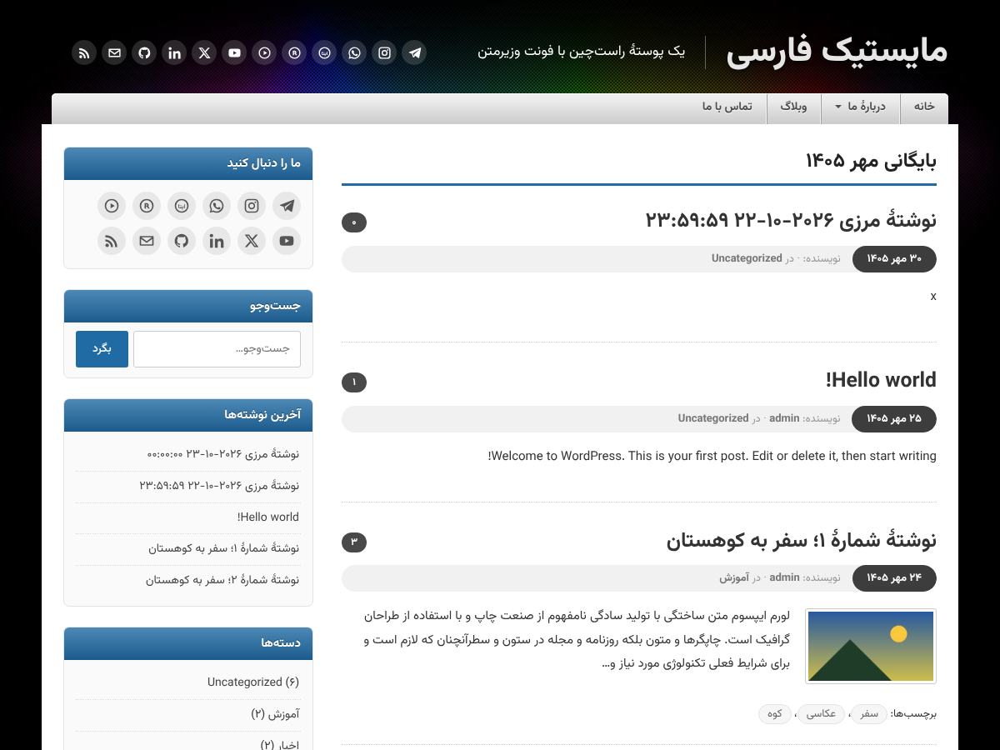

# وزیر (Vazir) — پوستهٔ وردپرس راست‌چین با فونت وزیرمتن

[English](#english) · فارسی

بازسازی سبک‌وزن، راست‌چین و سازگار با **PHP 7.4 تا 8.3** و **وردپرس 5.8+** از پوستهٔ کلاسیک Mystique، با فونت **وزیرمتن**. بدون فریم‌ورک و بدون وابستگی به افزونه. این پوسته پوستهٔ دائمی سایت [اسدی آنلاین](https://asadionline.ir/) است.

## ویژگی‌ها
- راست‌چین کامل و فونت وزیرمتن (فایل woff2 داخل خود پوسته، بدون سرویس خارجی)
- **تاریخ شمسی** و **ارقام فارسی**، و بایگانی با نام ماه‌های شمسی
- **حالت تاریک** با کلید روشن/تاریک و ذخیرهٔ انتخاب بازدیدکننده
- **منوی موبایل** کشویی، سربرگ چسبان و جست‌وجوی پنجره‌ای
- آیکن‌های شبکه‌های اجتماعی (ویجت و سفارشی‌سازی)
- طرح‌های رنگی با تنظیم خودکار کنتراست (WCAG AA)
- سئو و سرعت: Schema.org (JSON-LD)، breadcrumb، تصاویر WebP، preload، CSS فشرده درون‌خطی
- تنظیمات از «نمایش ← سفارشی‌سازی ← تنظیمات وزیر»

## نصب
1. از بخش [Releases](../../releases) یا دکمهٔ **Code ← Download ZIP** فایل را بگیرید.
2. در وردپرس: نمایش ← پوسته‌ها ← افزودن ← بارگذاری پوسته، فایل ZIP را انتخاب کنید.
3. فعال‌سازی. راهنمای کامل‌تر در [`README.txt`](README.txt).

> اگر `style.css` را ویرایش کردید، دوباره `python3 tools/minify.py` را اجرا کنید تا CSS فشرده به‌روز شود.

## مجوز و منابع
- کد: **GPL-2.0-or-later** (فایل [`LICENSE`](LICENSE)).
- طراحی و تصاویر سربرگ از پوستهٔ Mystique اثر [digitalnature](https://digitalnature.eu/themes/mystique/) (GPL)؛ کد این نسخه از نو نوشته شده است.
- فونت [Vazirmatn](https://github.com/rastikerdar/vazirmatn) با مجوز SIL OFL 1.1.

---

## English
**Vazir** is a lightweight, RTL-only WordPress theme (PHP 7.4–8.3, WP 5.8+) that rebuilds the classic *Mystique* look with the **Vazirmatn** font, built for Persian sites. Features: Jalali (Persian) dates and digits, dark-mode toggle, off-canvas mobile menu, modal search, social icons, WCAG-aware accent colors, JSON-LD/breadcrumbs, and performance tuning (WebP, preload, inlined minified CSS).

**Install:** download the ZIP → WordPress *Appearance → Themes → Add New → Upload Theme* → activate → *Customize → Vazir settings*.

**License:** GPL-2.0-or-later. Original design/art by digitalnature (Mystique, GPL); font Vazirmatn (SIL OFL 1.1). Live example: [asadionline.ir](https://asadionline.ir/).
